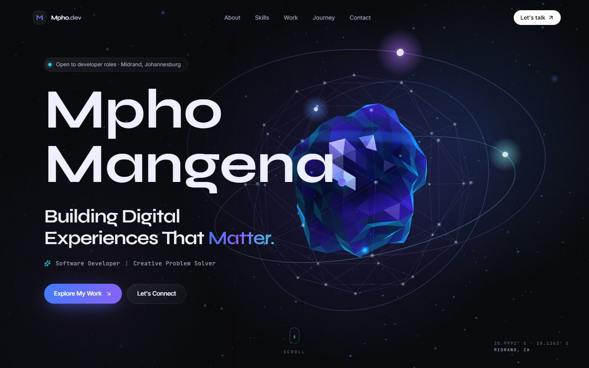

# Mpho Mangena: Developer Portfolio

**Live site → [dev-portfolio-sigma-nine.vercel.app](https://dev-portfolio-sigma-nine.vercel.app)**

My personal portfolio: an interactive 3D website showing my projects, skills and journey as a software developer based in Johannesburg.

[](https://dev-portfolio-sigma-nine.vercel.app)


## Highlights

- **Interactive 3D hero.** A faceted crystal shaped by a custom GLSL noise shader, inside a wireframe shell with orbiting satellites and a twinkling particle field. It follows your cursor and reacts more when you move the mouse quickly.
- **Scroll-driven storytelling.** The About statement lights up word by word, and the timeline glows as you scroll through it.
- **3D tilt cards.** Skill and project cards tilt toward the cursor, with a soft spotlight that follows the pointer.
- **Interactive contact background.** A rippling dot field that bends away from the cursor.
- **Smooth, polished motion.** Lenis smooth scrolling, magnetic buttons, an animated nav indicator and staggered reveals.

## Sections

| Section | What's inside |
| --- | --- |
| **Hero** | Name, headline, call-to-action buttons and the 3D scene |
| **About** | Introduction, interests, how I approach problems, and animated stats |
| **Skills** | 12 technologies in filterable cards (Frontend · Backend & Data · Tools) |
| **Work** | WeServa, LifeNest, HerPath and Queueless, with previews, tech stacks and links |
| **Journey** | Experience, certifications, hackathon finals and team projects |
| **Contact** | Email (with copy to clipboard), GitHub, LinkedIn and CV download |

## Built with

| | |
| --- | --- |
| **Framework** | React 19, TypeScript, Vite |
| **3D** | Three.js with React Three Fiber, custom GLSL shaders |
| **Styling** | Tailwind CSS v4, glassmorphism, self-hosted variable fonts (Syne, Inter, JetBrains Mono) |
| **Animation** | Framer Motion, Lenis |
| **Icons** | Lucide React, Simple Icons |
| **Hosting** | Vercel |

## Performance and accessibility

- **Fast first paint.** The 3D scene is code-split and loads in the background while the text renders immediately.
- **No wasted rendering.** WebGL pauses when the hero is off-screen, and the contact animation pauses when it isn't visible.
- **Adapts to the device.** Phones and lower-powered machines get fewer particles, simpler geometry and a lower pixel ratio.
- **No post-processing.** Glows are faked with additive sprites instead of a bloom pass.
- **Reduced motion.** With `prefers-reduced-motion` turned on, smooth scrolling is off and the animation slows down.
- **Accessible.** Semantic landmarks, a skip link, visible focus rings, a keyboard-friendly mobile menu (Escape closes it), and labelled links and images.

## Running locally

Requires **Node.js 20+**.

```sh
git clone https://github.com/mpho09/DevPortfolio.git
cd DevPortfolio
npm install
npm run dev
```

Then open http://localhost:5173.

| Command | Description |
| --- | --- |
| `npm run dev` | Start the dev server with hot reload |
| `npm run build` | Type-check and build for production into `dist/` |
| `npm run preview` | Serve the production build locally |
| `npm run typecheck` | Run the TypeScript checker only |

## Editing content

All of the site's text lives in `src/data`, so updating content doesn't mean touching components:

| File | Controls |
| --- | --- |
| `src/data/profile.ts` | Name, email, social links, CV path, navigation, About stats |
| `src/data/skills.ts` | Technology cards: icon, colour, category, description |
| `src/data/projects.ts` | Featured projects: copy, tech, links and preview type |
| `src/data/timeline.ts` | Experience, certifications and hackathons |

**Images:** project screenshots go in `public/projects/` (WebP, 1440×900 for browser previews) and the CV goes in `public/cv/`.

**Project previews:** each project's `preview` field can be one of:

- `{ kind: 'browser', src, url }`: a screenshot inside a browser frame
- `{ kind: 'phones', srcs: [a, b] }`: two mobile screens in phone frames
- `{ kind: 'weserva' }`: a hand-built interface preview, for projects without a public deployment

Set `githubPrivate: true` on a project to show a "Private repo" badge instead of a link visitors can't open.

## Project structure

```
src/
├── components/
│   ├── three/              HeroScene (lazy-loaded WebGL) and GLSL shaders
│   ├── layout/             Navbar, Footer
│   ├── ui/                 Button, TiltCard, Reveal, SectionHeading, BrandIcon
│   ├── ContactBackground   Interactive canvas dot field
│   └── ProjectPreview      Browser, phone and custom preview frames
├── sections/               Hero, About, Skills, Projects, Experience, Contact
├── hooks/                  useActiveSection, useMediaQuery
├── lib/                    Smooth scrolling and global pointer tracking
├── data/                   All site content
├── App.tsx
└── main.tsx
```

## Deployment

The site deploys to Vercel automatically on every push to `master`. Build settings are pinned in [`vercel.json`](vercel.json) (Vite preset, `npm run build`, output `dist/`), so no dashboard configuration is needed.

To deploy elsewhere, run `npm run build` and host the `dist/` folder on any static host, such as Netlify, GitHub Pages or Cloudflare Pages.

## Contact

**Mpho Mangena**, Software Developer, Midrand, Johannesburg

- Email: [mphomangena0409@gmail.com](mailto:mphomangena0409@gmail.com)
- LinkedIn: [linkedin.com/in/mphomangena](https://www.linkedin.com/in/mphomangena)
- GitHub: [@mpho09](https://github.com/mpho09)

---

© 2026 Mpho Mangena. The code is free to read and learn from. Please don't republish the site, its content or its design as your own.
